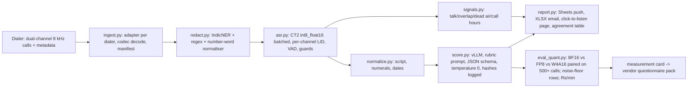

> Design brief produced 2026-10-27 in response to: "Simplismart raised $14M — why can we build on similar lines? Think of a more quantized version."
> Method: 4 web-research tracks → 4 independent product designs → 3-judge panel → synthesis → 3 adversarial reviews → revision → completeness critic → gap fill (18 agents). Numbers tagged (E) are estimates, (K) are pre-June-2026 knowledge to verify; see section 16a. The runner-up designs are in [alternatives.md](alternatives.md).

# Sankshep — design brief v3 (gaps filled after the second review): a quantization-powered, accuracy-measured call-QA service for Indian collections agencies and BPOs

## 1. TL;DR

**Can we build on similar lines?** Yes, if "similar lines" means what Simplismart actually sells — fewer GPUs per workload, on the customer's own cloud or premises, with India cost engineering — and no if it means a smaller Simplismart. Simplismart is a closed serving platform with 28 custom CUDA kernels, 58 people, NVIDIA on the cap table, >50% US revenue and, as of today, $14M of new capital at ~$100M post-money [TechCrunch; Inc42 2026-10-27]. It already sells T4/L4/A10G/A100 SKUs at 1.5-2.5x raw India rates, shipped an INT4-on-A10G deal (Sanas, H100 to A10G, -53%, vendor-reported), calls on-prem/air-gapped its own niche, and has Indian enterprise customers (Tata 1mg, Shiprocket, Apna) plus the Yotta partnership. A one-to-three-person team cannot out-engineer it on throughput and cannot win token resale ($0.02-0.14/M floor for 8B models). What it can do is build an application on the same open blocks (vLLM, llm-compressor, CTranslate2/Whisper, AI4Bharat ASR) for one buyer that Simplismart, Sarvam and the call-QA SaaS vendors do not serve well.

**What "a more quantized version" means — two readings, both kept.**

1. *Quantized scope (primary).* One product: 100%-coverage call QA (Mode A) for non-captive collections agencies and mid-size BPOs (300-3,000 seats), delivered under a written SLA ("every call that ends before 20:00 IST is scored by 08:00 IST"). One design partner signed before any product code. Hindi/Hinglish first; the partner's second language second (not Tamil by fiat). One rented L4 per ~500 seats on an Indian-region cloud. A solo founder for 16 weeks. Everything else — real-time voice, a quantization compiler, a card marketplace, bank/NBFC direct sales, air-gap bundles, a registry — is deferred until a paying customer asks.
2. *Quantization as the engineering thesis, not the commercial one.* FP8/INT8/W4A16 weights, FP8 KV cache and int8 ASR are how an 8-24B model plus Whisper fit on the cheapest India-region card with enough KV left for the batch the SLA needs. The proof is one table — BF16 8B / 12B / 24B first, then BF16 / FP8 / W4A16 of the chosen model, on the partner's own calls, with auditor agreement (kappa) and ₹/minute — measured, not estimated, with a BF16-vs-BF16 re-run as the noise floor. Precision never appears on the price sheet.

**What the second review changed (section 14b has the full list).** The buyer's economics were re-derived from analyst productivity rather than asserted: human QA costs ₹6-15 per *audited* minute loaded, an agency runs roughly one analyst per 30-50 agents, and Sankshep does not remove QA (flag triage, coaching, disputes stay). The net saving in the base case is 20-45% depending on the triage rate, so the pitch is coverage and NBFC-audit evidence, with price capped at ~35% of the partner's existing QA line (which lands at ₹0.10-0.12/min). The SLA is now written down and gate (b) is ≥ 50x real time per L4 at the call-minute, not 20x. The rubric (15 items), the statistic (per-item Cohen's kappa plus total-score MAE) and the pass rule are defined. The model and ASR bake-offs are scheduled for week 1, with defaults if the partner's data is late. Dual-channel recording is now a discovery question with a costed mono fallback. Residency is reframed: India-region storage is a sourced requirement for digital-lending NBFCs; on-prem is a preference. Self-hosting is forced by ASR-API economics (list prices are 3-4x our per-minute price), not by regulation. The per-node "your own GPU" SKU is conditional on discovery finding GPU owners. The licensing bill of materials is corrected (Gemma and Llama are not Apache-2.0). Toolchain pins are corrected from a live PyPI check (vLLM is at 0.32.0, not 0.20.x). The DPA/pilot term sheet, the security baseline, the design-partner acquisition plan, company prerequisites and a `decisions.md` are added.

**Honest outcome.** ₹6-10 lakh invoiced by month 6 (₹4-7 lakh collected, agencies pay net-30/60 with TDS); ₹50-80 lakh ARR by month 18 from 5-8 agencies/BPOs at 20% annual churn; cash-positive on a two-person team. Bootstrap from pilots plus cloud credits (~₹1-3 lakh real value) and IndiaAI Mission compute if eligible; raise ₹1-2 Cr from angels only after a design partner signs. Plausible acquirers: a CCaaS/dialer platform, an Indian cloud, Sarvam, Simplismart.

## 2. What Simplismart actually is and where we fit

**Facts.** Verute Technologies Pvt Ltd, Bengaluru, founded 2022 by Amritanshu Jain (CEO) and Devansh Ghatak (CTO); pivoted from AutoML to inference [SeedToScale 2024]. Series A $7M led by Accel, Oct 2024, ~$25-35M valuation [Entrackr 2024]. Series B $14M all-primary led by Dallas Venture Capital (~$5M) with NVIDIA, Accel, Shastra VC and Micromax, ~$100M post-money, announced today [TechCrunch; Inc42]. ~30 customers and >$1M ARR at Series A [Forbes 2024]; ARR claimed 14x in six months to "eight-figure"; Indian-entity FY25 revenue ₹1.22 Cr with a ₹9.02 Cr loss, implying US booking (hypothesis) [Entrackr/Tracxn]. 58 employees.

**Product.** Closed engine (28 custom CUDA kernels, kernel fusion, continuous batching, Eagle-3, torch.compile, multi-LoRA; the AWS Marketplace listing says it also sits on TensorRT/Triton/vLLM) plus a Terraform-like control plane with 140+ options; shared, dedicated, BYOC, on-prem, air-gapped [VentureBeat; AWS Marketplace]. Customers skew video/image (InVideo, HeyGen, Higgsfield) plus Shiprocket, Apna, Sanas, Tata 1mg. NVIDIA is a technical partner (Dynamo integrations).

**Quantization stance.** "FP16, FP8, and AWQ... FP8 is not supported on Ampere" [docs FAQ]; comparison pages add BF16/GPTQ; the config default is float16. Explainer recommends FP8 over INT8 and FP8 KV for larger batches. Public wins: Sanas INT4 (vendor-reported 99.99% task accuracy) and GLM-4.6 FP8+MTP ~142 tok/s under load. Nothing public on FP4/NVFP4, QAT, ternary, sub-8-bit KV or accuracy-guarded search.

**Benchmarks and pricing.** Llama-3.1-8B on one H100: 501 tok/s single-user peak, ~350 sustained; no methodology, no neutral audit. Serverless Llama-3.1-8B $0.13/M vs DeepInfra ~$0.02-0.05, Groq $0.05/$0.08 — not the price leader. Dedicated H100 $4.00/hr is roughly E2E's raw ₹379/hr; T4 $1.20, L4 $1.50, A10G $2.00 are 1.5-2.5x raw India rates.

**Where we fit.** We do not position against Simplismart. What Simplismart will not do for a ₹2-4 lakh/month customer, and what we build, is application-layer: 8 kHz Hindi/Hinglish telephony ASR tuned on collections calls, rubric scoring with auditor-agreement evidence, delivery into a QA head's workflow under an SLA, and per-language precision measurement on the customer's calls. Simplismart BYOC remains a valid substrate for a customer who already has it (our stack exposes an OpenAI-compatible endpoint either way) and a plausible acquirer.

## 3. The recommended product

**Name:** Sankshep (संक्षेप, "condensed").

**One-liner:** A 100%-audit call-QA service for Indian collections agencies and BPOs: 8 kHz Hindi/Hinglish dual-channel call recordings in, per-call rubric scores with timestamped evidence out — fair-practice compliance (RBI recovery-agent rules), script adherence, promise-to-pay and dispute capture, escalation flags, talk/overlap/dead-air signals — delivered by 08:00 IST into a Google Sheet, an XLSX by email and a click-to-listen web page, at ₹0.10-0.12 per audio-minute hosted on an Indian-region cloud; sold on measured agreement with their human auditors on their rubric. Underneath, the stack runs quantized (FP8/W4A16 LLM, int8 ASR) so one L4 carries ~500 seats under the SLA.

**3.1 Buyer unit economics, re-derived (replaces v2's "below their current QA spend").**

Every number below is an estimate to be replaced by the partner's own figures from the discovery script (section 10.2); the model is the point.

| Quantity | Value | Basis |
|---|---|---|
| Talk time per agent per day | 60-180 min; planning base 120 | Predictive/progressive dialers in collections yield 120-200 min connected talk; manual/progressive floors 60-80. Read from the partner's dialer report (E) |
| Audio-minutes per month, 1,000 seats | 1.56M (60) / 3.12M (120) / 4.68M (180) | seats x min/day x 26 days (E) |
| QA analysts | 1 per 30-50 agents → 20-33 for 1,000 seats | Indian voice-BPO norm (K, verify with partner) |
| Analyst cost | ₹30-35k CTC; ₹40k loaded (seat, supervisor share, QA tool) | (E) |
| Calls scored per analyst-hour | 3-5; collections calls average 3-6 min | → 12-30 audited min/hour, ~7 productive hours, 24 days → 2,000-5,000 audited min/month (E) |
| Human QA cost per audited minute | ₹8-20 loaded; ₹6-15 at CTC; planning ₹10 | ₹40k / 2,000-5,000 min. v2's ₹2-5/min implied 8,000-20,000 min per analyst per month, i.e. 5-12 hours of audio scored per 8-hour day — not possible (E) |
| Sampling actually achieved | 2-3% | 25 analysts x 3,000 min = 75k min of 3.12M (E) |
| QA budget line, 1,000 seats | ₹8-10 lakh/month | 25 x ₹40k (E) |
| Sankshep at ₹0.12/min on 3.12M min | ₹3.74 lakh/month | — |
| Residual human work after Sankshep | 0.5-1% of minutes for flag triage, disputes, coaching samples → 5-10 analysts → ₹2-4 lakh | Flags on a collections floor run 3-8% of calls; a human looks at every adverse flag (section 12.3) (E) |
| Net change in QA spend | ₹10 lakh → ₹5.7-7.7 lakh: **20-45% saving**, base case ~25% | Below the 30% threshold the review set |

**Consequence.** The product does not sell as "cheaper QA". It sells as (1) 100% coverage versus 2-3%, (2) NBFC-audit evidence (the agency can show its principal that every call was screened against the RBI recovery-agent rules), (3) penalty and de-empanelment exposure, and (4) a QA team redeployed from sampling to coaching. **Pricing rule:** per-minute price = min(₹0.12, 35% of the partner's current QA line / monthly minutes). On the base case that is ₹0.11/min; on a 300-seat agency (₹3 lakh QA line, 0.94M min) it is also ~₹0.11/min, so the rule and the ₹0.10-0.12 band agree across sizes. The CFO sees a budget-neutral line at a 1% triage rate and a saving below it.

**Penalty exposure (the number the brief did not have).** RBI's 12 August 2022 circular on recovery agents makes the regulated entity (bank/NBFC) responsible for its agents' conduct, and REs push that liability down through agency contracts: indemnities, per-incident penalties, and de-empanelment. RBI Ombudsman complaints have grown sharply (≈9.3 lakh in 2023-24, +33% YoY — K, verify in the latest Ombudsman annual report), with loans/advances and recovery conduct among the top grounds. No public per-agency penalty figure exists; it is collected in discovery (question D7). If the partner cannot name a penalty, chargeback or de-empanelment in the last 12 months, the pitch is coverage plus budget substitution only, and the 35% rule holds the price.

**3.2 Who pays and why.**

| Buyer | Budget line | Why they pay | Who mandates QA |
|---|---|---|---|
| Non-captive collections agencies and mid-size BPOs (300-3,000 seats); the Head of Quality or VP Operations can sign a ₹1-2 lakh pilot alone | Human QA (₹8-10 lakh/month at 1,000 seats); QA-SaaS seat fees where present (₹1,500-5,000/seat/month list, K, verify by quote) | 100% coverage by 08:00, evidence for NBFC audits, flagged calls with audio for the QA team, at ≤ 35% of the QA line | The NBFC's agency contract usually requires 100% recording and a QA sample; the NBFC audits the agency (verify per partner, D9) |
| NBFC/MFI collections operations | Agency oversight | Reached through the agency's reports; not sold direct in year one (6-12 month cycles, IS questionnaires, often ISO 27001 asked — K) | They are the principal; our reports are their evidence |
| CCaaS/dialer platforms (Exotel/Ameyo, Ozonetel, C-Zentrix) | Reseller margin | Channel, after two direct wins; also potential competitors (section 7) | — |

**3.3 What the QA head sees (product surface, raised to the competitors' minimum).**

- **Per-item output schema** (JSON per call, English field names, evidence in the transcript's script): `{call_id, scored_at, sla_deadline, model_sha, prompt_sha, asr_sha, engine_image, items:[{id, score, evidence_quote, start_ms, end_ms, channel, for_human_review}], captures:{ptp_amount_inr, ptp_date, ptp_channel, dispute_reason, callback_time, hardship_reason, reference_number}, signals:{agent_talk_pct, customer_talk_pct, overlap_pct, interruptions, max_dead_air_s, call_start_local, duration_s}, total_score, flags:[...]}`.
- **Click-to-listen page** on the node (1-2 days of work): per call, each rubric item with its evidence quote and a play button that streams the 10-second snippet around `start_ms` from the dual-channel file via signed URLs (24-hour expiry, IP allowlist); HTTPS with per-customer named logins (QA head, 2-3 auditors) and an access log of who listened to what. Every adverse flag carries the label "for human review" in the UI and in the contract.
- **Acoustic signals** (`signals.py`, from the two VAD timelines): agent/customer talk ratio, overlap percentage, interruption count (one side starts while the other is active for > 0.5 s), longest dead air (both silent > 5 s), hold detection, call start time and duration from dialer metadata. The RBI calling-hours item (08:00-19:00) is scored from metadata only.
- **Delivery:** nightly Google Sheets push (gspread, service account, one tab of per-call rows and one of flags) plus XLSX by email, because most agencies run QA in Sheets/Excel; a webhook/CSV export for Credgenics/Spocto-class platforms only if the partner uses one (verify). Dashboard p50/p95 "minutes from call end to score" shown against the SLA.

**What it is not:** not an inference platform, not a quantization devtool, not a card marketplace, not a voice bot in year one, not a bank vendor in year one, not a GPU cloud.

## 4. Why quantization still matters here: evidence table

Quantization's value in this vertical is fit and throughput under the SLA, not a headline cost cut. The commercial anchor is "100% coverage at ≤ 35% of the QA line"; a vLLM BF16 deployment on an L40S achieves most of that too. The quantization-specific delta is shown on the ₹/min meter.

| Method | Precision | Gain | Accuracy cost (English benchmarks unless stated) | Hardware | Source | Role in Sankshep |
|---|---|---|---|---|---|---|
| FP8 dynamic W8A8 | 8-bit W+A | ~2x weight memory; +44%-class throughput | 99.75% recovery, effectively lossless 8B-405B | Ada/Hopper/Blackwell (SM 8.9+) | ACL 2025 arXiv 2411.02355 | Default for 8-14B on L4/L40S |
| INT8 W8A8 (SmoothQuant+GPTQ) | 8-bit | Llama-3.1-8B 14.9 to 8.0 GB; L40S 576 to 830 out tok/s | Deltas below benchmark std-error | Ampere and up; T4 INT8 tensor cores also work | Red Hat 2026-09-14 | Only if a customer owns Ampere (hwdb entry; no SKU) |
| W4A16 GPTQ/AWQ g128 | 4-bit weights | ~3.5x weight memory; little throughput gain over W8A8 at high batch | 99.36% mean recovery; worst task 96.9% | Marlin on SM 7.5+ | ACL 2025; vLLM marlin_utils | 24B on 24 GB (Sarvam-M 24B) if the rubric needs it |
| Gemma 4 QAT w4a16 / Q4_0 | 4-bit, QAT by vendor | Same as PTQ W4 | ~1-2% vs BF16 (third-party) | Any | Google 2026-06-05 (Q) | Candidate for 12B; Gemma Terms of Use, on-node only (section 5.2) |
| FP8 KV cache | 8-bit KV | 2x KV capacity; H100/FA3 speed numbers do not transfer to L4 | >=97-99% uncalibrated on Qwen3; sliding-window layers must be skipped on Gemma/gpt-oss | L4 via FlashInfer/Triton with per-tensor scales | vLLM blog 2026-04-22 | Capacity lever on L4: 2x concurrent calls in the scoring batch; measured week 6 |
| INT8/INT4 KV (LMDeploy) | 8/4-bit KV | 2x/4x capacity | Model-dependent; head_dim 256 untested | Volta and up | LMDeploy kv_quant doc | Only for a customer-owned Ampere/Turing box |
| TurboQuant KV | 3-4-bit KV | 3.4x capacity at 66-80% of BF16 throughput | 1-4 pt (4-bit); ~-20 pt reasoning (3-bit) | H100 (vLLM); Ampere/Ada via LMDeploy | vLLM blog 2026-05-11 | Not used (call transcripts are 3-8k tokens; FP8 suffices) |
| NVFP4 | 4-bit W+A | B200: 9,367 vs 2,297 tok/s/chip FP8 | ~99% recovery 70B+; 95-98% at 7-14B | Blackwell only; SM120 bugs open | SemiAnalysis; Red Hat 2026-02-04 | Not in scope |
| W4A8 (QServe; Marlin W4A8-FP8) | 4/8 | Llama-3-8B on L40S 3,656 tok/s (QServe engine) | ppl 6.89 vs 6.14 | Not available in vLLM for our targets | mit-han-lab/omniserve | Not shipped |
| QAT/QAD (torchao, llm-compressor QADModifier) | 4-bit after ~1-5k steps | Same memory as PTQ W4 | Gemma 3 QAT cut Q4_0 ppl degradation 54% | Any | Google 2025-04 | Fallback for <= 4B models only; separate image |
| Ternary (BitNet b1.58) | 1.58-bit | 2.37-6.17x CPU speedup | Only natively trained models; none Indic | CPU | microsoft/BitNet | Not used |
| "Indic INT4 tax" | 4-bit | — | AWQ-int4 -4.7 / GPTQ-int4 -3.8 pts on low-resource languages in a long-context benchmark; a Hindi/Kannada translation study found INT4 preserved human-rated quality; thin and conflicting | — | EMNLP 2025 arXiv 2505.20276; arXiv 2509.23990 | A two-day experiment on partner calls, normalised by tokens/word |
| Reasoning models | 4-bit / KV4 | — | Near-lossless only >=14B; CoT inflates | — | COLM 2025; arXiv 2606.00206 | Out of scope (thinking mode off) |
| Tokenizer fertility | — | Dominates KV and prefill | Llama-3 tokenizers ~2.5-4 tokens per Devanagari word; Mistral/Sarvam-M ~2-3; Gemma (262k vocab) ~1.5-2; Qwen3 ~2.5-3 (all K, measured in week 1) | — | measured per model | Mandatory field on every measurement: tokenizer tokens / whitespace words after indic-nlp normalisation |
| Whisper via CTranslate2 int8_float16 | int8 | large-v2 int8 batch 8: 13 min of audio in 16 s on an RTX 3070 Ti (~49x); turbo has 4 decoder layers vs 32 | WER delta gated (section 6.3) | GPU/CPU | faster-whisper README (Q) | Mode A ASR; prior for L4 turbo: 80-150x on VAD-gated speech (E), measured week 0 |

**The 24 GB-card arithmetic, now tied to the SLA.** Qwen3-8B KV is 144 KiB/token at FP16 (36 layers x 8 KV heads x 128 dim x 2 x 2 B), 72 KiB at FP8. A scored call is a 3-8k-token prompt (10 minutes of two-party Hindi is 1,200-1,800 words; 2.5-3 tokens/word on Qwen3, 1.5-2 on Gemma) plus a 500-800-token JSON answer. On an L4 with `gpu_memory_utilization=0.90` (~20.2 GiB): BF16 Qwen3-8B leaves ~3.5 GB for KV → 25k tokens → 4 concurrent 6k-token calls, so decode runs at batch 4 and the card is decode-bound; FP8 weights leave ~10 GB → 145k tokens at FP8 KV → ~24 concurrent calls, where the card is prefill-bound (an 8B at 5k tokens is ~8e13 FLOP, 0.8-1.6 s at 60-100 effective TFLOPS) and decode at batch 24 runs ~350-400 tok/s aggregate (10-14 tok/s per stream). Planning numbers: **~3-4 s per 10-minute call for an 8B FP8 (150-200x real time on the LLM pass); ~7-8 s for a 24B W4A16 at batch 8 (75-85x)**. ASR at 80-150x. End to end, time-sliced, 55-75x with an 8B and 40-50x with a 24B. That is why gate (b) is 50x and why the 24B is the case where quantization is "fit" rather than a cost line.

## 5. Technical architecture

**5.1 Pinned image and versions (checked against PyPI on 2026-10-27).**

`pip index versions` today: **vllm 0.32.0** (released 18 Oct; default wheels and `vllm/vllm-openai:v0.32.0` image built for CUDA 13.0, `-cu129` tags available; 0.31 renamed `quantization="fp8"` to `fp8_per_tensor`, 0.30 made AutoRound 2-7-bit loadable on CUDA — a reminder that pins matter), **llmcompressor 0.14.0.1**, **ctranslate2 4.8.4**, **faster-whisper 1.2.1**. v2's "vLLM 0.20.x" was stale by twelve releases. Pins for six months:

| Container | Image / version | Note |
|---|---|---|
| LLM | `vllm/vllm-openai:v0.32.0` (CUDA 13.0) or `v0.32.0-cu129` if the node driver is < 580 | `nvidia-smi` driver must meet the image's CUDA runtime (CUDA 13.0 → driver ≥ 580.x; 12.9 → ≥ 575.x; verify against NVIDIA's CUDA release-notes table on the day). Record the E2E node's driver, vCPU and RAM in `decisions.md` on day 1 (the plan page was unreachable in this pass; requirement is ≥ 8 vCPU, ≥ 32 GB RAM for batched VAD/decoding plus Postgres) |
| ASR | our image: `nvidia/cuda:12.x-cudnn-runtime` + faster-whisper 1.2.1 + ctranslate2 4.8.4 + silero-vad + torchaudio (CPU) | Separate from vLLM so the two never share a torch |
| Quantizer (build host only, never on the node) | llmcompressor 0.14.0.1 + torch per its lockfile | Builds run on a rented A100/L40S; artifacts copied to the node |
| Control plane | python 3.11, FastAPI, SQLModel, Postgres 16 | One `docker-compose.yml` |

**5.2 Components and the corrected licence bill of materials.**

| Component | Choice | Licence | Redistribution rule |
|---|---|---|---|
| LLM engine | vLLM 0.32.0 | Apache-2.0 | — |
| Ampere KV alt (hwdb only) | LMDeploy 0.12.x TurboMind INT8 KV | Apache-2.0 | — |
| Scoring model, candidates (bake-off section 6.1) | Qwen3-8B / Qwen3-14B | Apache-2.0 | May be published quantized on HF with public/synthetic calibration |
| | Sarvam-M 24B | Apache-2.0 (K, verify HF card) | Same |
| | Gemma 4 12B (QAT w4a16) | **Gemma Terms of Use** (use restrictions; terms and prohibited-use policy must flow down to any recipient; "Gemma" naming) | On-node only; never published by us; terms flow-down clause in the customer agreement |
| | RedHatAI Llama builds | **Llama Community License** ("Built with Llama" notice, "Llama" prefix on derivative names, AUP) | Not used unless a bake-off forces it; never published by us |
| ASR | faster-whisper large-v3-turbo (OpenAI Whisper weights) | MIT (code and weights) | Publishable |
| | IndicWhisper (Vistaar) | MIT (repo states licence covers the fine-tuned models — Q) | Publishable |
| | IndicConformer-600M (NeMo fork, `nemo-v2` branch) | MIT (Q); no ONNX/sherpa export exists | Publishable; export is a 1-2-week job, deferred |
| VAD | Silero VAD | MIT | — |
| Normalisation / transliteration | indic_nlp_library (MIT, Q); IndicXlit `ai4bharat-transliteration` (MIT, Q, both directions) | MIT | — |
| Redaction | ai4bharat/IndicNER (MIT per HF card — K, verify; HF was unreachable in this pass) + regex (PAN, Aadhaar, phone, account/UPI) + the number-word normaliser | MIT | Runs on the node before anything leaves it |
| Mono fallback (only if a dialer delivers mono) | pyannote-audio (code MIT, Q); pipelines `speaker-diarization-3.1` / `community-1` are gated behind HF user conditions (Q) | MIT + gated terms | Accept conditions under the company account; log the terms in the BOM |
| Eval | lm-evaluation-harness 0.4.13, jiwer, our scripts, GuideLLM | MIT / Apache-2.0 | — |
| Synthetic demo TTS | Indic Parler-TTS (Apache-2.0 — K, verify) or Sarvam Bulbul API | per vendor | Demo audio only |
| Control plane | FastAPI, SQLModel, Postgres 16, gspread | MIT etc. | — |

**Publishing rules (written into the DPA and the measurement card).** (1) Only Apache-2.0 bases (Qwen3, Sarvam-M) are ever published as quantized checkpoints; Gemma and Llama artifacts stay on the node with terms flow-down. (2) Any artifact that leaves a partner's node is calibrated only on public or synthetic data (IndicVoices/Kathbath transcripts, our LLM-generated collections dialogues); partner transcripts are used only for private on-node artifacts. (3) Every artifact ships a `BOM.json` with each model's licence and the sha256 of the checkpoint files.

**5.3 Data flow.**



**5.4 Ingestion per dialer, storage and the mono fallback.**

Dual-channel recording is a discovery question (D11-D14), not an assumption. What is known pre-call (all K, verify with the partner's vendor):

| Dialer | Deployment | Stereo available? | Codec / format seen | Export path | Ingest adapter |
|---|---|---|---|---|---|
| Exotel (incl. Ameyo, acquired 2022) | Cloud / Ameyo on-prem | Exotel API has a dual-channel recording option (verify parameter name and whether the partner's plan enables it); Ameyo recorder configurable | MP3 8 kHz (Exotel); WAV/GSM 6.10/MP3 (Ameyo) | Recording URL via API; Ameyo file share/SFTP | `exotel` (API pull by date range), `sftp` |
| Ozonetel CloudAgent | Cloud | Verify; mono MP3/WAV is the default seen | MP3/WAV | API / S3-style URL | `ozonetel` |
| C-Zentrix | On-prem / cloud | Verify | WAV/MP3 | File share / SFTP | `sftp` |
| Knowlarity (Gupshup) | Cloud | Likely mono (verify) | MP3 | API | `generic_url` |
| Genesys / Avaya + NICE/Verint recorders | On-prem (large BPOs) | Usually stereo-capable | WAV mu-law / G.729 | Recorder export job | `sftp` |

`ingest.py` decodes any of mu-law WAV, GSM 6.10, MP3 (8-16 kbps), Opus and G.729 (ffmpeg) to 16-bit PCM per channel, resamples 8 → 16 kHz for Whisper, and writes a manifest row (call_id, agent_id, start_time, duration, channels, codec, sha256). Build the partner's adapter in week 3; one adapter, not five.

**Storage and uplink.** mu-law is 480 KB per channel-minute: 1.56M min/month (500 seats) is 750 GB per channel raw. Ingest compressed: the dialer's MP3 at 16 kbps (120 KB/min) or transcode to Opus 12 kbps (90 KB/min) → 2 channels x 1.56M = 280-375 GB/month; 30-day retention on the node's NVMe plus object storage at ~₹2-3/GB/month (E2E, K, verify) is ₹1-2k/month at 500 seats, ₹3-4k at 1,000. The agency's uplink is 10-25 GB/day — 1-2.5 Mbps sustained, or ~10-15 Mbps for a 4-hour nightly push; both are ordinary for a 300+-seat floor.

**Mono fallback (costed).** If the partner's dialer delivers mono: pyannote `community-1` (gated, MIT code) or NeMo diarization; ~1 week of integration, 0.5-1x the ASR GPU time, and overlap segments lose speaker attribution. Items that depend on who said what (threats, identification) are then scored with lower confidence and flagged for review. The pilot still runs; the per-minute price does not change; the partner is asked to enable stereo for the contract term.

**5.5 GPU memory budget and scheduling on one L4 (24 GB; ~22.5 GiB usable).**

Default: **time-slicing in hourly cycles** — the orchestrator drains the queue every hour: ASR pass (CT2 gets the card), then LLM pass (vLLM gets the card at 0.90). Switch cost is ~1-2 min per cycle (vLLM load of an 8-13 GB checkpoint from NVMe) ≈ 3% of the hour, and each pass gets the whole card, which matters because scoring is batch-hungry. Co-residency (vLLM at 0.68 ≈ 15.3 GiB, CT2 ≤ 5 GiB, 2 GiB headroom) is the week-6 experiment; adopt it only if measured end-to-end throughput exceeds time-slicing by > 10%.

| Pass | Component | Memory (E, measured week 3) |
|---|---|---|
| ASR | large-v3-turbo CT2 int8_float16 weights | ~1.6 GB |
| | batch 16 x 30 s activations + VAD | ~2.5-3.5 GB |
| | **peak** | **~5 GB** |
| LLM | vLLM at `gpu_memory_utilization=0.90` | 20.2 GiB total budget |
| | Qwen3-8B FP8 weights | 8.2 GB |
| | CUDA graphs + activations at batch 24-32 | ~1.5-2 GB |
| | KV (FP8, 72 KiB/token) | ~10 GB → ~145k tokens → ~24 x 6k-token calls |
| | Sarvam-M 24B W4A16 weights (if chosen) | ~13 GB → KV ~5.5 GB → ~12 calls at FP8 KV, ~6 at FP16 |
| | Gemma 4 12B w4a16 | ~7-8 GB weights; KV layout unknown until measured; sliding-window layers skipped for FP8 KV |

Launch flags recorded per deployment: `--max-model-len 12288 --max-num-seqs 32 --kv-cache-dtype fp8 --kv-cache-dtype-skip-layers sliding_window --enable-prefix-caching --seed 0`; attention backend printed to the log and the card.

**5.6 Hardware tiers (hosted L4 is the year-one product; the rest are hwdb entries).**

| Tier | GPU | Recipe | Status |
|---|---|---|---|
| Ada hosted | L4 24 GB (E2E ₹49/hr, Q via research digest, verify on the price page; AWS Mumbai g6 ~₹80/hr, K) | FP8 W8A8 for 8-14B; W4A16 for 24B; FP8 KV | **Year-one product.** One L4 per ~500 seats at 120 min/agent-day under the 08:00 SLA; L40S (~₹100/hr) when a 24B or > 800 seats per node is needed |
| Hopper | H100 (₹379/hr) | BF16/FP8 references | Reference runs only (bake-offs use A100-80 at ₹189/hr or AWS/GCP credits) |
| Ampere (customer-owned) | A10G / A100 | INT8 W8A8, W4A16 Marlin, LMDeploy INT8 KV | hwdb entry; a per-node SKU exists only if discovery finds ≥ 2 of 10 prospects with a GPU or a Mumbai VPC (section 10.4) |
| Turing (customer-owned) | T4 | W4A16 Marlin, INT8; fp16-overflow gate; no FlashInfer | hwdb entry only |
| CPU | 32 vCPU | llama.cpp ≤ 4B; CT2 int8 ASR 20-40x (E) | Branch-office batch only; not an SKU |
| Blackwell | — | — | Out of scope |

**5.7 Security baseline for the hosted pilot (one page, attached to the questionnaire pack).**

LUKS full-disk encryption on the node and object storage with provider-side encryption; SSH keys only, no password auth, non-root user, fail2ban; no public ports except 443 (click-to-listen page, IP-allowlisted to the agency's egress) and 22/SFTP (allowlisted); per-customer Linux users and directories, per-customer Postgres schema; audio retained 30 days then deleted by cron with a deletion log; scores and evidence quotes retained for the contract term; no off-node backups of audio (Postgres backups contain scores and quotes only, encrypted, Mumbai region); audit log of every page view, snippet play and export; secrets in a `.env` with 600 permissions (no vault in year one); weekly `apt`/image patching; incident contact and 72-hour notice in the DPA. A trimmed SIG-Lite/CAIQ is pre-filled once (two days) and reused. VAPT (₹50-80k) is scheduled when the first NBFC questionnaire demands it, not before.

**Mode B (deferred) latency rules, recorded for when it is built:** start TTS on the first clause; <= 4B dialog model; cap an L4 node at ~30-40 voice calls; Kokoro on the GPU; tokens-per-Hindi-word reported on every measurement. If pursued, an OEM engine for one CCaaS at revenue share.

## 6. The quantization pipeline in detail

**6.1 Model decision: a week-1 bake-off, then the smallest model that passes.**

Candidates: Qwen3-8B, Qwen3-14B, Gemma 4 12B, Sarvam-M 24B, all at BF16 (thinking mode off), on a rented A100-80 (~6 h, ~₹1.2k, or AWS/GCP credits). Input: 20 partner calls transcribed by the chosen ASR, or — if partner data is late — the 20 LLM-generated Hinglish collections dialogues from the synthetic demo (section 10.3). Each model scores all 20 calls against the draft rubric (section 6.3) with the same prompt and JSON schema; the contract analyst checks every item decision (20 calls x 15 items = 300 decisions; ±5 pp resolution). **Selection rule: the smallest model within 3 pp item agreement of the best**, provided JSON validity ≥ 99% and script integrity passes. Tie-break: Apache-2.0 over Gemma terms; lower tokens/word over higher. The decision is re-checked at week 9 on the 200-call set (kappa), where "smallest within 0.02 kappa of the best" is the rule. Section 6.2's table therefore starts with a BF16 8B / 12B / 24B row before any precision row, because model size, not precision, is the real decision.

**Fine-tuning: prompt-only for the pilot.** The rubric prompt carries the partner's script, the RBI items with definitions, three worked examples per graded item, and the output schema. LoRA SFT on partner labels is a week-9+ option, taken only if gate (c) fails by < 0.05 kappa on ≥ 3 items. If taken: train the adapter on the BF16 base (PEFT, 1-2 h on an A100), serve it as an adapter over the quantized base in vLLM (multi-LoRA over quantized bases is supported in recent vLLM for GPTQ/AWQ/FP8/compressed-tensors — K, verify with a one-hour test in 0.32.0; fallback = merge into BF16 and requantize with the canonical recipe), and re-run the paired BF16-vs-quantized test with the adapter on.

**Checkpoint selection, not recipe search.** Order of preference: vendor QAT checkpoint > RedHatAI pre-quantized FP8 build > our own llm-compressor 0.14.0.1 build with the canonical recipe (`QuantizationModifier(scheme="FP8_DYNAMIC")`, or `GPTQModifier(targets="Linear", scheme="W4A16", ignore=["lm_head"])` with 512 x 2,048 chat-templated samples, `add_special_tokens=False`, evaluate with `add_bos_token=True`). Hard rules: embeddings and `lm_head` ≥ 8-bit; no format without a kernel on the target SM; per-layer mixed precision only via HIGGS/AutoScheme if a 24B fails on 24 GB; nothing below 4-bit.

**6.2 The one experiment (weeks 5-6, two days of compute).** On all 500+ partner calls (no human labels needed for paired rows) plus the 200 double-scored calls (absolute rows), the 2k-dialogue domain set and MILU hi/ta/en as a canary:

| Row | What it measures | Statistic |
|---|---|---|
| **BF16 8B vs 12B vs 24B** (new, first) | Does the rubric need a bigger model? | kappa vs auditor A per item on 200 calls; item agreement on 500 calls vs the 24B as reference |
| **BF16 batch 1 vs BF16 batch 32** (noise floor) | Batch-size nondeterminism at temperature 0 | per-item flip rate; total-score MAE; mean token KL |
| **BF16 run A vs run B, same batch** (noise floor) | Engine determinism | same (expected ~0) |
| BF16 vs FP8 | The default tier | per-item flip rate ≤ 3% (95% upper bound ≤ 4%) on 500 calls; kappa loss ≤ 0.05 on 200 calls; total-score MAE ≤ 1.5 |
| BF16 vs W4A16 (English ultrachat calibration vs Indic/synthetic-collections calibration, 256/1,024 samples) | The fit tier and the "Indic tax" question | same, plus tokens/word |
| FP16 KV vs FP8 KV (on the chosen precision) | Capacity lever | same, plus calls/hour and ₹/min |

Every row reports tokens/word, attention backend, engine image digest and ₹/min. v2's H1 ("Indic calibration recovers at least half of the INT4 tax") stays a hypothesis: the likelier drivers are tokenizer fragmentation and under-trained non-Latin weights, and the FP8 tier uses no calibration at all. Publish the table either way (week 13+). Hinglish has no public benchmark, so the partner-derived domain set is the Hinglish gate.

**6.3 The rubric, the statistic, and the gates.**

**Starter rubric v0 (15 items + captures).** Sources: RBI circular of 12 August 2022 on regulated entities' recovery agents (calling hours 08:00-19:00; no intimidation or harassment, verbal or physical; no humiliation or intrusion on family/referees/friends; no threatening or anonymous calls; no persistent calling; no inappropriate messages — K, circular number to be verified), the NBFC Fair Practices Code in the Scale-Based Regulation Master Direction (no undue harassment, odd-hour calls, muscle power), the Digital Lending Directions (recovery-agent details communicated to the borrower; LSP data in India) and the partner's own call script.

| # | Item | Type | Source | Scored from |
|---|---|---|---|---|
| 1 | Call started between 08:00 and 19:00 borrower local time | binary | RBI 2022 | metadata only |
| 2 | Agent states own name | binary | script / RBI identification | agent channel |
| 3 | Agent states lender/NBFC and agency name | binary | script / RBI | agent channel |
| 4 | Borrower identity confirmed before any loan detail is disclosed | binary | FPC / confidentiality | both channels |
| 5 | No loan details disclosed to a third party (family, colleague, wrong number) | binary | RBI 2022 | both |
| 6 | No threat, intimidation, abuse or humiliation (incl. threats of police/legal action not in the script) | binary | RBI 2022 / FPC | agent |
| 7 | No false representation (fake authority, fake deadlines, fake consequences) | binary | FPC | agent |
| 8 | Borrower's request to stop/callback/dispute acknowledged (no persistent-calling signal) | binary | RBI 2022 | both |
| 9 | Outstanding amount and due date stated and consistent with the CRM record (if CRM field provided) | binary | script | agent + CRM |
| 10 | Grievance/escalation channel offered when the borrower disputes | binary | FPC | agent |
| 11 | Recording disclosure made (if the script requires it; else metadata/IVR flag) | binary | script | agent |
| 12 | Promise-to-pay captured with amount, date and channel | binary + capture | script | both |
| 13 | Empathy and tone in hardship cases | graded 1-3 | partner | agent |
| 14 | Resolution quality / clarity of next step | graded 1-3 | partner | both |
| 15 | Script adherence overall | graded 1-3 | partner | agent |
| C | Captures: PTP amount (₹ integer), PTP date (ISO), channel, dispute reason (10-class), callback time, hardship reason, reference number | fields | — | both |

Calls under 20 s score items 1-3 only. Total score = 100 x weighted mean (binary items weighted 2, graded 1, after the partner's weights).

**Statistic and pass rule.** Unit of analysis: the call, per item. Binary items: Cohen's kappa; graded items: quadratically weighted kappa; captures: exact-match accuracy after normalisation; whole call: MAE of total score (0-100). **Gate (c) pass rule: kappa(model, auditor A) ≥ kappa(auditor A, auditor B) − 0.05 on ≥ 80% of items (12 of 15), and total-score MAE(model, A) ≤ MAE(A, B) + 2 points, and capture accuracy ≥ auditor-auditor agreement − 5 pp.** Both auditors score blind; the model is compared to each and the better of the two comparisons is reported alongside the worse.

**Sample design and CI widths (precomputed).** 200 calls = 120 random + 80 enriched (calls with any human flag or a Sankshep screening flag), so that rare items (6, 7, 5) have ≥ 15-20 positives; kappa is reported on the random subset (unbiased) and on the full set (rare items). Expected 95% bootstrap CI (2,000 call-level resamples): kappa ±0.12 at 10% prevalence and ±0.09 at 30% prevalence with n=200; percent agreement ±4-5 pp; total-score MAE ±0.7 points. A "≤ 1 pt drop" clause is therefore only testable paired; the quantized-vs-BF16 comparison is run paired on all 500+ calls (per-item flip rate SE ≈ 0.6 pp at 2% discordance), with the two BF16-vs-BF16 rows as the noise floor.

**Gates (per language, vs a BF16 reference on the same engine).**

| Gate | Computable definition | Threshold | Status |
|---|---|---|---|
| Auditor agreement (200 calls) | per-item kappa, weighted kappa, total MAE, capture accuracy as above | Pass rule above | Primary — gate (c) |
| Quantized vs BF16 (500+ calls, paired) | per-item flip rate; kappa loss on 200; total MAE | flip ≤ 3% (upper 95% ≤ 4%); kappa loss ≤ 0.05; MAE ≤ 1.5; all above the BF16-vs-BF16 noise rows | Primary — gate (e) |
| Domain set (2k dialogues) | intent accuracy (10 classes), slot F1 (8 slots), JSON validity | drop ≤ 1 pt (paired CI); JSON ≥ 99.5% | Primary |
| Script integrity | per response: share of letters in {Devanagari, Latin} (or {Tamil, Latin}) ≥ 0.98; share of 5-grams occurring ≥ 3 times ≤ 0.2; JSON parses | ≤ 0.1% of responses fail any check | Primary |
| ASR entity error | entity-level F1 on {amount, date, phone, name} vs human transcript after normalisation; error = (1 − F1) in pp | int8 vs FP16 delta ≤ +1.0 pp (upper 95% bound, ≥ 4,000 entities; v2's +0.3 was below the noise at this n); absolute ≤ 5 pp for QA, < 2 pp before any automation use | Primary for ASR |
| ASR WER | Devanagari WER (comparability with published numbers), transliterated WER (tWER, both sides through IndicXlit Indic→Latin, lowercase, punctuation stripped, numerals to digits) and CER | int8 vs FP16 delta ≤ +0.5 abs per language and dataset | Reported, gated at the delta |
| ASR hallucination on non-speech | share of VAD-silent windows that produce text | ≤ 0.5% after guards | Gated |
| MILU per language | lm-eval YAML; paired SE | Reported, not gated | Canary |
| Logit fidelity | mean and p99 token KL(quant‖BF16) on 2k Indic prompts, next to the same artifact's English KL and tokens/word | Reported; informal expectation mean ≤ 0.05 / p99 ≤ 0.5 nats for 8-bit, ≤ 0.1 / 1.0 for W4A16 (Unsloth Q4_K_M reference: mean KLD 0.019) | Reported |
| Long context (8-16k summaries, if used) | judge = the BF16 scoring model with a fixed judge prompt, 1-5 scale, paired | drop ≤ 2% | When used |
| Efficiency | call-minutes scored per L4-hour vs the cheapest SKU where BF16 fits | ≥ 1.5x, or BF16 does not fit at the SLA batch | Gate (e) |
| Reproducibility | every call record stores temperature 0, seed 0, `max_tokens`, sha256 of model manifest, prompt template + rubric version, ASR model, VAD params, normaliser version, engine image digest, launch flags | 100% of records | Required |
| Tokens/word | tokenizer tokens / whitespace words after indic_nlp normalisation (NFC, Devanagari normaliser) on the 2k transcripts | Reported per model | Required field |

**6.4 ASR path, specified.**

- **Week-3 default (if the bake-off is late):** faster-whisper 1.2.1, `large-v3-turbo`, `compute_type="int8_float16"`, `BatchedInferencePipeline` with `batch_size=16`, `language="hi"` forced per channel, `beam_size=1` (5 in the bake-off), `condition_on_previous_text=False`, no temperature fallback, `compression_ratio_threshold=2.4`, `log_prob_threshold=-1.0`, `no_speech_threshold=0.6`, Silero VAD with `min_silence_duration_ms=500`, and a hallucination guard that drops segments with a repeated-5-gram ratio > 0.3 or from a 40-phrase known-hallucination list.
- **Week-1 bake-off** on 30 partner calls (≈150 audio-min, 15-25 analyst-hours to transcribe) or, if late, 30 synthetic calls plus the GramVaani 8 kHz test set: (1) large-v3-turbo int8_float16 forced `hi`; (2) the same with a Hinglish `initial_prompt`; (3) IndicWhisper-medium converted with `ct2-transformers-converter` (int8_float16); (4) IndicConformer-hi via the NeMo fork (FP16; no CT2 path); (5) Sarvam Saarika (batch API; code-mixed and telephony claims — K); (6) one of Google Chirp 3 / Deepgram Nova-3 (Hindi). Decision rule: lowest tWER with entity F1 within 2 pts of the best; ties go to self-hosted. API prices (K, verify): Saarika ≈ ₹30/hour (₹0.50/min), Google ≈ $0.016/min (₹1.3), Deepgram Nova-3 ≈ $0.0077/min (₹0.65), AssemblyAI ≈ $0.0025/min (₹0.21), OpenAI gpt-4o-transcribe ≈ $0.006/min (₹0.50). **At ₹0.21-1.3/min, API ASR costs 2-10x our ₹0.12/min price; self-hosting is forced by economics at any production volume, independent of residency.** APIs are used only as bake-off references and, if the partner's clause permits, as a fallback.
- **Code-switch policy.** Whisper forced to `hi` writes English words in Devanagari ("पेमेंट"); forced to `en` romanises Hindi; auto-detect flips per 30-s window. Decision: force `hi` on both channels (the scoring model reads Devanagari-English fine), restrict language detection to the partner's language set {hi, ta, en} to stop Urdu/Marathi/Punjabi flips, and evaluate WER in a script-agnostic Latin form (tWER). Human references are written as the transcribers naturally write Hinglish (Devanagari for Hindi, Latin for English, digits for numbers); normalisation maps both sides to the same form.
- **Per-channel / per-segment LID.** Run `detect_language` on the first three VAD segments of each channel; a Hindi agent with a Tamil customer gets `hi` on the agent channel and `ta` on the customer channel. If within-channel confidence < 0.6, fall back to per-segment detection within the allowed set.
- **Normalisation standard (`normalize.py`, versioned).** indic_nlp Devanagari normaliser + NFC; punctuation and filler stripping; Indian number words to digits for Hindi and English ("paanch hazaar" → 5000, "do lakh" → 200000, "dedh"/"dhai"/"sava"/"paune" handled, "pandrah sau" → 1500); lakh/crore to digits; dates ("pandrah tareekh", "15 ko", "agle somvar") resolved against the call date to ISO; months in Hindi/English; phone numbers read digit by digit; amounts tagged with "rupaye"/"₹". Entity extraction for the entity-error metric runs on the normalised text of both the hypothesis and the reference.

**6.5 KV cache.** Ada: FP8 e4m3 KV with per-tensor static scales via FlashInfer/Triton; `--kv-cache-dtype-skip-layers sliding_window` on Gemma; measured against FP16 KV at the deployment's context in week 6; it is a capacity lever (2x calls in the scoring batch), not a speed claim. No sub-8-bit KV anywhere in year one.

**6.6 Speculative decoding.** n-gram/prompt-lookup only (JSON output is highly templated); verify in 0.32.0; auto-disable below 1.15x at the observed median batch. For batch scoring on an L4 it will likely auto-disable, which is the correct outcome.

**6.7 Artifact export.** compressed-tensors safetensors (vLLM), CTranslate2 int8_float16 (faster-whisper). Each artifact ships `serve.sh`, `BOM.json`, the measurement card (JSON + HTML: per-item kappa vs BF16 with paired CI, flip rate, KL, tokens/word, attention backend, ₹/min, toolchain digests, calibration-data provenance: public/synthetic/partner-private) and a sha256 manifest.

**6.8 Benchmarking.** GuideLLM plus an 8 kHz audio load generator; conversion to ₹/audio-minute and calls/L4-hour. Drift monitoring and nightly rebuilds stay out of the first 16 weeks.

## 7. Differentiation and the honest commoditization risk

| Who | What they sell | Price basis (K unless noted; verify by quote as a 500-seat agency) | Hindi / 8 kHz / collections | Our slot |
|---|---|---|---|---|
| Convin (Bengaluru) | 100% call audit, coaching, compliance workflows | per agent per month, custom; third-party estimates ₹4-8k/agent/month | Hindi/Hinglish yes; collections templates exist | We are per-minute (≈ ₹375/agent/month at 120 min/day), measured against *their* auditors, on an Indian-region node |
| Enthu.AI (Pune) | Call QA, scorecards | list ≈ $20-60/user/month (₹1.7-5k) | Hindi yes | Same; we add RBI items and evidence timestamps |
| Observe.AI, Level AI, Salesken | Enterprise QA/agent-assist | ₹5-10k+/seat/month, enterprise terms | Hindi partial; enterprise sales | Not our buyer |
| Prodigal (US) | Collections-specific QA/agent-assist | custom | US English, FDCPA | Not in India |
| Ozonetel / Exotel-Ameyo / C-Zentrix speech-analytics add-ons | QA bundled into the dialer | per-seat add-on, ₹300-800/seat/month (E); may be bundled "free" in enterprise plans | Hindi claims; 8 kHz native | **The real threat**: QA at zero marginal cost inside the partner's dialer. Discovery D15 asks whether the partner's dialer already bundles it; the counter is accuracy evidence on collections calls and the RBI item set |
| Credgenics, Spocto X (Yubi) | Collections platforms with voice bots and analytics | per-account/per-loan pricing | Hindi bots; analytics as a module | Possible integration target, possible competitor; verify feature set in discovery |
| Sarvam AI | Indic models, Saarika ASR, Bulbul TTS, Samvaad agents; on-prem for BFSI via HCLTech | Saarika ≈ ₹30/hour (K) | Yes | Competitor on every component and a possible acquirer; also our API fallback if a clause allows |
| Skit.ai, Gnani.ai | Collections voice bots to banks/NBFCs | per-call/per-minute bot pricing | Yes | Not customers; our QA audits bot and human calls alike |
| Simplismart | Closed engine, BYOC/on-prem | GPU-hour | — | Substrate/fallback and acquirer; never positioned against |
| Red Hat / NVIDIA / Intel OSS | Free quantization algorithms | — | — | We use them |

**The wedge, restated with numbers.** At ₹0.12/min and 120 min/agent-day, Sankshep is ~₹375 per agent per month — a tenth of a QA-SaaS seat and below the dialer add-on band. The wedge holds unless the partner's dialer bundles QA for free, which discovery must establish before pricing is finalised.

**Commoditization risk, stated plainly.** Every algorithm and kernel belongs to Red Hat, NVIDIA, Intel, ggml or Arm; labs ship native low-precision checkpoints; Red Hat could ship `llmcompressor gate` in a quarter; Simplismart could copy a card in a sprint; Sarvam can QAT its own models and publish per-language cards. The independent-optimization-layer base rate is acquisition within 2-3 years.

**What is actually ours.** (1) A private, consented, entity-labelled 8 kHz BFSI telephony test set contributed by paying partners under a DPA that explicitly permits retention of a redacted, hashed subset (section 12.2). (2) Rubric libraries per agency and the agreement tables that prove them. (3) The measured per-language precision table on real collections calls. (4) Delivery inside the QA head's workflow under an SLA. Not moats: the planner, gateway, card format, recipes, compose file.

## 8. Build plan: 16 weeks, solo founder

| Week | Milestone | Hard output |
|---|---|---|
| 0 | **Admin:** file SPICe+ incorporation (Pvt Ltd, ₹15-30k professional fees, 7-15 days), apply for DPIIT Startup India recognition (free, 1-3 weeks), Udyam MSME registration (free; brings the MSMED 45-day payment rule), GST registration (needed to invoice B2B), bank account on incorporation. **Legal:** one-page term sheet to the lawyer (section 12.2). **Tech:** rent one L4 for one hour (₹49): measure faster-whisper large-v3-turbo int8_float16 batched throughput on 8 kHz band-limited audio; record driver/vCPU/RAM. Draft rubric v0; write the discovery script; build the 50-target list; start the synthetic demo | ASR prior (x real time) in `decisions.md`; target list |
| 1 | 50 outreaches; synthetic demo finished (2 days); LLM bake-off on 20 synthetic dialogues (A100, 6 h); ASR bake-off on 30 synthetic + GramVaani; apply for IndiaAI compute, AWS Activate, Google for Startups, NVIDIA Inception | Bake-off tables; demo on screen |
| 2 | 10 discovery calls (script 10.2); 2-3 data conversations; NDA + DPA drafts out; QA economics and penalty numbers collected; dialer/format facts collected; contract QA analyst lined up | Discovery sheet with D1-D20 per prospect |
| 3 | Design partner signs NDA + DPA + pilot term sheet; 500+ calls and existing QA scores arrive via the partner's dialer path; `ingest.py` adapter | **Gate (a)** |
| 3-6 | Pipeline on one L4: ingest → redact → ASR → normalise → score → signals → Sheets/XLSX/page; bake-offs re-run on 20-30 partner calls; analyst transcribes 30 calls (ASR), starts the 200-call set with the partner's two auditors (≈ 70 auditor hours, weeks 4-7, committed in the pilot agreement), and the 2k-dialogue domain set (LLM pre-label, human verify, weeks 4-8); GuideLLM + audio load; the three-row and noise-floor tables (weeks 5-6) | **Gate (b)** at week 6 |
| 7-11 | Four-week nightly 100%-audit pilot inside the partner's workflow (free for the design partner; compute at our cost); weekly 30-min review with the QA head; rubric v1; agreement table at week 9 | **Gate (c)** week 9; **Gate (e)** week 9 |
| 11-12 | Convert the partner to per-minute at 50% off year one (3-month minimum, 50% invoiced in advance); second prospect's paid pilot (₹1-2 lakh fixed) by referral; publish the precision table and lm-eval YAMLs | First invoice |
| 13-16 | Second pilot; questionnaire pack (security baseline, SIG-Lite, measurement card); the per-node variant only if discovery found GPU owners | **Gate (d)** week 16 warning, week 20 stop |

After gate (d) only: calibration research, agent-assist, the partner's second language at scale, Mode B as an OEM engine, Helm/air-gap, hire #2.

## 9. Repo scaffold and `decisions.md`

```
sankshep/
  pyproject.toml           # private; extras: [asr], [eval]
  decisions.md             # one-line defaults (below); updated, never deleted
  BOM.json                 # licences + sha256 per model/artifact
  sankshep/
    ingest.py              # adapters: exotel | ozonetel | sftp | s3 | manual; codec decode; manifest
    redact.py              # IndicNER + regex + number-word normaliser; runs before anything leaves the node
    asr.py                 # faster-whisper CT2 int8_float16 batched; per-channel LID; VAD; guards
    normalize.py           # script/numeral/date normalisation; tWER helpers; versioned
    score.py               # rubric prompts, vLLM client, JSON schema, hashes per call
    signals.py             # talk ratio, overlap, interruptions, dead air, call hours
    report.py              # Sheets push, XLSX email, click-to-listen page (signed URLs), agreement table
    bench.py               # GuideLLM wrapper, audio load generator, Rs/min meter
    eval_quant.py          # paired BF16/FP8/W4A16 + noise-floor rows; MILU canary; KL; entity error; card
  docker-compose.yml       # vllm + asr + api + postgres; hourly cycle orchestrator; cron + alerting
  evals/tasks/             # lm-eval YAML (milu_hi/ta/en, domain_intent, domain_slots) — the only open-source part
  evals/registry.csv       # name, licence, sample rate, domain, split, sha256 (section 11.3)
  evals/manifests/         # hashes only; audio and transcripts stay with the partner
  legal/termsheet.md       # pilot term sheet + DPA clause list (section 12.2)
  security/baseline.md     # section 5.7; SIG-Lite answers
```

**`decisions.md` (defaults; each is a half-hour decision that otherwise becomes a week of rework).**

- audio-minute = call duration in minutes as reported by the dialer, both channels included, billed to the second; calls < 20 s scored on items 1-3 only and billed at actual duration.
- real-time factor = call-minutes fully processed (ingest to sheet) per wall-clock minute on one node, with both channels VAD-gated.
- SLA = every call that ends before 20:00 IST is in the sheet by 08:00 IST the next day; ≥ 98% of ingested calls; p50/p95 latency reported.
- second language = the partner's second language by call share (read from the dialer's language field or LID on 1,000 calls), not Tamil by default.
- scoring model = winner of the week-1 bake-off; smallest within 3 pp item agreement; prompt-only for the pilot; LoRA is a week-9+ option.
- ASR = faster-whisper large-v3-turbo int8_float16 forced `hi`, unless the bake-off beats it by ≥ 2 pts tWER with equal entity F1.
- redaction = ai4bharat/IndicNER + regex (PAN, Aadhaar, phone, account/UPI, card) + number-word normaliser; redaction map stored on the node only.
- output language = English field names; evidence quotes verbatim in the transcript's script; captures normalised (ISO dates, integer rupees).
- scheduling = hourly time-sliced cycles (ASR pass, then LLM pass); co-residency only if week 6 shows > 10% gain.
- determinism = temperature 0, seed 0, top_p 1, fixed `max_tokens`; batch-size flip rate measured and reported.
- audit trail = model/prompt/ASR/engine/normaliser hashes per call in Postgres; prompt templates and rubric versions in git with tags.
- alerting = cron health checks; email + Telegram alert if a cycle fails or the 06:00 backlog projection misses 08:00; manual re-run runbook.
- retention = audio 30 days on the node; scores and quotes for the contract term; redacted, hashed test-set subset retained only under the DPA clause.
- publishing = Apache-2.0 bases only; public/synthetic calibration for anything that leaves a node.
- pricing = min(₹0.12/min, 35% of the partner's QA line / monthly minutes); 3-month minimum; 50% invoiced in advance.
- churn assumption = 20% annual in the ARR table.
- GPU-owner SKU = exists only if ≥ 2 of 10 discovery prospects own a GPU or run a Mumbai VPC.

## 10. GTM: design partner, first 10 customers, pricing

**10.1 Design-partner offer.** Free 4-week pilot (our compute, ~₹40k) plus 50% off year one (₹0.06/min, 3-month minimum thereafter), in exchange for: ≥ 500 dual-channel calls with existing QA scores and the rubric; two auditors for ≈ 70 hours over weeks 4-7 to double-score 200 calls; weekly 30-minute reviews; a reference call and a redacted case study; and consent to retain a redacted, hashed test subset (section 12.2). The same partner is **not** expected to pay the ₹1-2 lakh pilot; the first paid pilot is customer #2.

**10.2 Discovery script (collected on every call; drives the price, the SLA, the ingest adapter and the GPU-owner decision).**

| # | Question | Decides |
|---|---|---|
| D1 | Seats, shifts, working days; talk time per agent per day from the dialer report | volume, node count |
| D2 | Number of QA analysts, CTC, calls scored per analyst per day, average call length | human QA ₹/min |
| D3 | Sampling % actually achieved; who picks the sample | coverage pitch |
| D4 | QA-SaaS or dialer speech-analytics in use; price per seat; contract end date | wedge vs seats; dialer-bundled threat |
| D5 | Rubric in use; weights; scale; who owns it (agency or NBFC) | rubric v1; IP clause |
| D6 | Who mandates QA: the NBFC contract (sample %, audit cadence) or the agency | buyer of evidence |
| D7 | Penalties, chargebacks, de-empanelment, Ombudsman escalations in the last 12 months (₹ and count) | penalty pitch |
| D8 | Languages by call share | second language |
| D9 | NBFC data-handling clause: residency (India region? on-prem?), sub-processor approval, audit rights | residency base case |
| D10 | Own GPU server or Mumbai VPC? Who runs IT? | per-node SKU |
| D11 | Dialer vendor and version; cloud or on-prem | adapter |
| D12 | Stereo/dual-channel recording: yes/no; codec, format, sample rate | mono fallback |
| D13 | Retention and export path (API, S3, SFTP, portal) | ingest |
| D14 | CRM fields available per call (loan id, outstanding, due date, DPD bucket) | item 9, captures |
| D15 | Does the dialer vendor already offer/bundle AI QA? at what price? | competition |
| D16 | IVR recording disclosure in place? | consent warranty |
| D17 | Vendor onboarding: IS questionnaire, ISO 27001 asked?, insurance asked? | questionnaire pack, VAPT timing |
| D18 | Payment terms, TDS section applied, PO process, who signs a ₹1-2 lakh pilot | gate (d) timing |
| D19 | How disputes and agent actions flow from a QA flag today | human-in-the-loop rule |
| D20 | What would make them stop the pilot in week 2 | kill signals |

**10.3 Getting meetings without BFSI relationships (three weeks).** 50 outreaches to Head of Quality/Training, VP Operations, and founders/COOs at agencies ≤ 1,000 seats in Mumbai/Thane/Navi Mumbai, NCR (Noida/Gurugram), Bengaluru, Hyderabad, Chennai, Pune, Indore. Sources: the recovery-agent/agency lists that banks and NBFCs publish on their websites (publication requirement under RBI's recovery-agent and fair-practice rules — K, verify the current requirement), MFIN member disclosures, dialer vendors' customer logos and case studies, LinkedIn titles ("Quality Manager" + "collections/recovery"). Three warm intros via dialer account managers (Exotel/Ameyo, Ozonetel) who have a reason to help (we drive recording volume). Expected funnel: 50 → 10 calls → 3 data conversations → 1 signed. **Something on screen for the first meeting:** a 2-day synthetic demo — 20 LLM-generated Hinglish collections dialogues (PTP, dispute, hardship, wrong number, third-party, threat case, odd-hour case), rendered with an Indic TTS in two voices, mixed to dual-channel, band-limited 300-3,400 Hz, resampled to 8 kHz with a G.711 codec pass and floor noise, run through the pipeline, shown on the click-to-listen page with the RBI items flagged.

**What "stop" at week 3 means.** This product (collections QA for agencies) stops. The search does not: the same stack and the ten discovery calls point to the next buyer (support-BPO QA on the same per-minute model, or an NBFC's captive floor), but no pivot is pre-approved; the founder decides with the discovery sheet in hand.

**10.4 The GPU-owner question.** Non-captive agencies and 500-3,000-seat BPOs almost certainly do not own A10G/A100 boxes; banks and NBFCs do, and they are not year-one buyers. Rule: if fewer than 2 of 10 discovery prospects own a GPU or run a Mumbai VPC, the per-node SKU is dropped from year one, section 15.5 is restated around hosted L4-vs-L40S cost and VPC footprint, and Ampere/Turing stay as hwdb entries. Sequence: design partner (weeks 0-3) → free pilot → paid pilot #2 by referral (agencies serving the same NBFCs) → channel via dialer vendors after two direct wins → credibility publishing from week 13.

**10.5 Pricing (INR; derived from the partner's QA invoice, not a modelled API stack).**

| SKU | Price |
|---|---|
| Design-partner pilot (4 weeks) | Free; 50% off year one |
| Paid pilot (customers #2+; 4 weeks, nightly 100% audit, agreement report) | ₹1-2 lakh fixed, 50% in advance, or ₹0.15/audio-minute |
| Mode A hosted on an Indian-region cloud | ₹0.10-0.12/audio-minute by the 35% rule; 3-month minimum; invoiced monthly, 50% in advance for the first quarter |
| Mode A on the customer's GPU, per node per year | ₹4-6 lakh; **offered only if discovery finds GPU owners** |
| Rubric customisation / integration | ₹50k-1.5 lakh one-time |
| Quantization audit for an ISV | ₹1.5-3 lakh, opportunistic |

**Reference math (500 and 1,000 seats, 120 min/agent-day).** 500 seats: 1.56M min/month → ₹1.87 lakh/month at ₹0.12; one reserved L4 (₹36k) + storage (₹2k) + analyst share → ~75% gross margin; 60k min/day under the 12-hour rule needs 43x per node, inside the 50x gate. 1,000 seats: 3.12M min → ₹3.74 lakh; two L4s (₹72k, 19% of revenue); 120k min/day → 87x fleet → 2 nodes at 50x (one at 100x). At 180 min/agent-day, add a node; at 60, halve. Compute per minute: ₹0.016 at 50x, ₹0.008 at 100x.

**Targets (estimates; 20% annual churn).** Month 6: ₹6-10 lakh invoiced, ₹4-7 lakh collected, 2 customers. Month 12: 4-5 customers, ₹25-40 lakh ARR. Month 18: 5-8 customers (7-10 gross adds), ₹50-80 lakh ARR.

**Global lane.** None in year one.

## 11. Costs, prerequisites, credits and eval data

**11.1 Sixteen-week cash (founder unpaid).**

| Item | ₹ |
|---|---|
| Reserved L4 for the pilot node, 4 months (₹49 x ~730 h) | 1.45 lakh (or ₹30-40k on-demand if the pilot slips) |
| Week-0 L4 hour; A100-80 bake-off and references (~100 h x ₹189); L40S FP8 references (~20 h); ASR API bake-off minutes | ~25k (AWS/GCP credits can cover the bake-offs: AWS Activate Founders up to $1,000, Google for Startups up to $2,000 without an investor, Microsoft Founders Hub up to ~$5,000 — K, verify current terms; NVIDIA Inception gives no cash) |
| Storage/egress | ~5k |
| Contract QA analyst (transcribe 30 calls, co-build 200-call set, verify 2k dialogues; 3-4 weeks of work, not a side task) | 45-75k |
| Legal: term sheet, NDA, DPA, pilot agreement | 30-50k |
| Incorporation, GST, DPIIT, Udyam, bank | 15-30k |
| Professional indemnity + cyber cover (₹25-50 lakh) | 15-40k (E) |
| **Total** | **₹3.2-4.5 lakh (~$4-5.5k)** |

**Payment reality.** Agencies pay net-30/60 and deduct TDS (2% u/s 194J for technical services or 10% professional — confirm per customer, D18); GST at 18% is added on top. Gate (d) is therefore "invoiced and ≥ 50% collected", and the first quarter is invoiced 50% in advance. Udyam registration makes the MSMED 45-day rule available as leverage.

**11.2 Twelve-month run-rate.** Founder plus hire #2 (at ~₹50 lakh ARR): ₹25-45 lakh; compute ₹6-10 lakh (pilot nodes passed through); VAPT when demanded ₹50-80k; legal/insurance ₹2-3 lakh; sales travel ₹3 lakh. **₹40-65 lakh.** Financing: pilots; credits (~₹1-3 lakh real value); IndiaAI Mission compute (apply in week 1; subsidised rates are for approved startups and are H100-class, so useful for references, not the L4 node — verify eligibility); angels ₹1-2 Cr only after a partner signs.

**11.3 Eval registry (`evals/registry.csv`; sample rates and licences as found on 2026-10-27, hashes filled on download).**

| Set | Licence | Rate | Domain | Use |
|---|---|---|---|---|
| Kathbath (IndicSUPERB) | CC0 (dataset), MIT (code) (Q) | m4a, resampled 16 kHz | read speech; Hindi 150 h, Tamil 185 h; noisy test-known/unknown splits (Q) | WER baseline; band-limited to 8 kHz + G.711 as the telephony proxy |
| IndicVoices | CC-BY-4.0 (HF card — K, verify; GitHub page states none) | 16 kHz after preprocessing | 76% extempore, 15% conversational, 8% read; no telephonic (Q) | conversational WER; public calibration transcripts |
| Svarah | licence not on GitHub (verify HF) | not stated | 9.6 h Indian English, 117 speakers, read + conversational (Q) | English-in-Hinglish check |
| Lahaja | licence not on GitHub (verify) | WAV, rate not stated | 12.5 h Hindi, 132 speakers, 83 districts (Q) | dialect robustness |
| GramVaani (Interspeech 2022 Hindi challenge) | challenge/research terms (verify before any commercial use) | 8 kHz telephony | 100 h Hindi; IndicWhisper 26.8% WER (Q) | the only public 8 kHz Hindi set; bake-off reference |
| FLEURS hi/ta | CC-BY-4.0 | 16 kHz | read | canary |
| Common Voice hi/ta | CC0 | 48 kHz MP3 | read | canary |
| MILU hi/ta/en | verify HF licence | text | MCQ knowledge | canary only |
| Synthetic Hinglish collections set (ours) | CC-BY-4.0 by our choice | 8 kHz rendered | 20-200 TTS-rendered dialogues | demo; public calibration; schema tests |
| Partner 8 kHz set | DPA-governed, private | 8 kHz | 500+ calls; 200 double-scored; 2k redacted dialogues | gates (c), (e); hashes only in the repo |

**Domain-set schema.** 10 intents: PTP, dispute, hardship, wrong number, callback, refusal, already paid, third party, escalation, other. 8 slots: amount, date, channel, reason, reference number, agent name, lender name, callback time. LLM pre-label (the BF16 scoring model) with human verification by the analyst; inter-annotator check on 100 dialogues.

## 12. Risks, kill criteria, legal and liability

**12.1 Five dated gates, no pre-approved pivots.**

| Gate | Date | Pass | Fail |
|---|---|---|---|
| (a) Data partner | Week 3 | Signed NDA/DPA/pilot term sheet; ≥ 500 dual-channel (or mono with fallback) calls + their QA scores + rubric; auditor hours committed | Stop this product |
| (b) Throughput under the SLA | Week 6 | ≥ 50x real time per L4 end to end at the call-minute (both channels, VAD-gated), measured with GuideLLM + audio load on the partner's actual daily volume; hosted tier capped at ~500 seats per L4 until measured higher | Restrict hosted tier to ≤ 300 seats per node and re-price, or sell per node if discovery found GPU owners, or stop |
| (c) Accuracy | Week 9 | kappa(model, A) ≥ kappa(A, B) − 0.05 on ≥ 12 of 15 items; total MAE ≤ MAE(A, B) + 2; captures ≥ auditor agreement − 5 pp; on 200 double-scored calls with bootstrap CIs | One LoRA attempt (two weeks) if within 0.05 on ≥ 3 items; else stop |
| (e) Model size and precision | Week 9 | Either the smallest passing model does not fit BF16 on the L4 at the SLA batch and its quantized version loses ≤ 0.05 kappa and ≤ 3% item flips vs BF16; or quantization gives ≥ 1.5x call-minutes per L4-hour at the same loss bound | Quantization leaves all external material; it stays a ₹/min cost line on the meter; we sell plain QA |
| (d) Cash | Week 16 warning, week 20 stop | ≥ ₹5 lakh invoiced to ≥ 2 unrelated end customers and ≥ 50% collected | Stop |

**12.2 Pilot term sheet and DPA clause list (to the lawyer in week 0; ₹30-50k).**

Roles: NBFC = data fiduciary; agency = data processor under its NBFC contract; Sankshep = sub-processor to the agency, named in the agency's NBFC notification where the NBFC contract requires it. Purposes: (1) QA scoring of call recordings; (2) on-node calibration/evaluation of models; (3) retention of a redacted, hashed test subset (≤ 1,000 calls, names/numbers removed by `redact.py`, audio hashed and encrypted, no re-identification) beyond the pilot for regression testing — explicit, separate consent line. Processing location: India region (Mumbai) only; no cross-border transfer. Retention: audio deleted 30 days after scoring (deletion log provided); scores and evidence quotes retained for the contract term; all partner data deleted 30 days after termination except the consented test subset. Security: section 5.7 baseline as an annex. Breach notice: 72 hours to the agency. Audit rights: annual, on notice, plus questionnaire responses. Sub-processors: the cloud provider (named), no others without written notice. Call-recording consent: the agency warrants that its IVR/script discloses recording and that its NBFC contract permits QA processing by a sub-processor (D16). Model/artifact rules: Gemma/Llama terms flow-down if used; no partner data in any artifact that leaves the node. Deliverable and SLA: scores for ≥ 98% of ingested calls by 08:00 IST for calls ending before 20:00; failures re-run within 24 h. Accuracy: "reported against your auditors on your rubric; not warranted"; the agreement table is the deliverable. Remedy: re-run, or credit capped at the month's fee; no consequential damages; liability cap = fees paid in the preceding 3 months. Human-in-the-loop: every adverse flag is labelled "for human review"; the customer agrees that no agent termination, penalty or NBFC report is based on a Sankshep flag without human review of the audio. IP: customer owns scores and its rubric; Sankshep owns pipeline, prompts, models and the measurement methodology; jointly developed rubric items licensed to both. Exclusivity: none. Term: 4-week pilot, then monthly with a 3-month minimum. Fees: free for the design partner; ₹1-2 lakh fixed for paid pilots, 50% in advance.

**DPDP status (K; confirm with the lawyer on the pilot dates).** The DPDP Rules 2025 were notified on 13 November 2025 with phased commencement: Board-related rules immediately, consent-manager registration at 12 months, and the substantive obligations (notice, consent, security safeguards, breach notification, retention/erasure, rights) at 18 months — i.e. around May 2027. During a pilot in Nov 2026-Mar 2027 the operative regime is still the IT Act s.43A and the SPDI Rules 2011 (financial information is "sensitive personal data"; consent for collection/disclosure; "reasonable security practices", with ISO 27001 as the named standard), plus the NBFC's RBI-driven outsourcing policy. The DPA is written DPDP-ready so that May 2027 needs no renegotiation.

**Residency, sourced where it can be.** RBI's data-localisation circular of April 2018 covers payment-system data, not call recordings. RBI's Digital Lending Directions (2025, consolidating the September 2022 guidelines) define LSPs to include entities performing recovery of a loan on behalf of an RE and require LSP-held data to be stored on servers in India (K; verify clause). The Master Direction on Outsourcing of IT Services (April 2023) requires REs to control sub-contracting and keep audit access, not on-prem processing (K; verify). Conclusion: **India-region storage and processing is the base requirement for an agency serving digital-lending NBFCs; on-prem is a customer preference.** Mumbai-region APIs are therefore not excluded by rule; they are excluded for ASR by cost (section 6.4) and allowed for the LLM as a fallback behind the same OpenAI-compatible interface where the NBFC clause permits (D9).

**12.3 Residual risks (monitored, not pivots).**

| Risk | Signal and response |
|---|---|
| 8 kHz Indic telephony ASR is the binding constraint (IndicWhisper 26.8% on GramVaani; Hinglish worse) | tWER and entity error on partner calls in week 4; QA tolerates higher WER than automation; nothing voice-related is promised until entity error < 2 pp |
| The partner's dialer bundles AI QA at zero marginal cost | D15 before pricing; respond with accuracy evidence on collections calls and the RBI item set, or move to that dialer as a channel |
| Net QA saving < 30% | Base case already; pitch is coverage, NBFC evidence and penalty exposure; 35% price rule |
| Mono recordings | Costed diarization fallback (section 5.4); stereo requested for the contract term |
| Sarvam, Simplismart or Red Hat publish Indic per-language, per-precision cards | The product survives on auditor agreement and workflow, which they do not sell to agencies |
| QA-SaaS incumbents add Hindi 8 kHz accuracy at agency price points | Lose on depth; respond with per-minute price, residency and agent-assist, or sell to one |
| Quantized Whisper hallucinates amounts on silence | > 0.5% after guards forces FP16 ASR; budget allows it |
| Toolkit churn (vLLM ships every two weeks; 0.31 renamed a quantization flag) | One pinned image for six months; upgrades only on customer need |
| Wrongful adverse action on a model flag | "For human review" label in UI and contract; audio attached to every flag; no automated actions |
| Licence surprises | `BOM.json` on every artifact; Gemma/Llama on-node only; a flagship artifact losing its licence is swapped within a week |
| Revenue ceiling | Accepted; the plan is sized for it |

## 13. Ideas grafted from the other approaches

**Kept.** The hardware DB generated from vLLM/LMDeploy capability code; the measurement-card JSON; the "audit + recipe" engagement as opportunistic revenue; GOLD/SILVER grading; `x-precision`/`x-recipe` response headers; the speculative-decoding and KV rules; reproducible GuideLLM runs; the optional fallback to any OpenAI-compatible endpoint including Simplismart or Mumbai-region APIs; the per-device perf gate; the QAD tier as the fallback for ≤ 4B models; adapter-only updates for later on-prem refreshes.

**Deferred or removed.** The sensitivity scan + ILP + promote loop; the card-only SKU, BYOC fee and "pay nothing" anchor; the public precision ledger; the GitHub Action; cosign/registry; the Jetson SDK; Tamil TTS; Mode B; the weekly BF16 shadow drift check; nightly rebuilds; the Sarvam-as-partner pitch; the Ampere/Turing SKUs (now hwdb entries pending discovery).

## 14. What the skeptics changed (v1 → v2)

1. Quantization as the commercial thesis demoted to engineering thesis (sections 1, 3, 4). 2. "The tier India owns" and the priced T4 tier removed (2, 4, 5). 3. Voice-AI ISVs and CCaaS moved from customers to competitors/channel (7, 10). 4. NBFC/CISO regulatory pull treated as a bar, not demand (3, 12). 5. Card-only SKU and global lane killed (10). 6. sankshep-forge not built; HIGGS/AutoScheme if ever needed (5, 6.1, 9). 7. "Indic INT4 tax" demoted to a two-day experiment (4, 6.2). 8. BharatVoiceEval renamed to a private partner-contributed set (7, 8, 11). 9. Simplismart repositioned as substrate/acquirer (2). 10. Sarvam as competitor (7). 11. Pricing anchor corrected (10). 12. Bootstrap financing (1, 11). 13. Open-core limited to eval YAMLs and tables (9). 14. Mode B deferred with corrected latency rules (5). 15. CPU tier limited (5). 16. L4 concurrency arithmetic corrected (4). 17. Ada FP8 KV plan corrected (6.5). 18. Hardware-DB "truths" corrected (5). 19. Gate thresholds rewritten (6.3). 20. ASR path corrected (5). 21. QServe/≤3-bit/mixed-precision rows corrected (4, 6). 22. Compute budget re-done (11). 23. Drift monitor and nightly rebuilds removed (5, 6.8). 24. One product, seven files (8, 9). 25. Demos replaced by the partner's 200 calls (8). 26. Five dated gates (12). 27. Solo plus contract analyst (8). 28. Dependencies that stood (technical).

## 14b. What the second review changed (v2 → v3)

1. **Buyer economics** re-derived from analyst productivity (₹6-15/audited-min; 1 analyst per 30-50 agents; residual triage kept); net saving 20-45%; pitch rewritten around coverage, NBFC evidence and penalty exposure; the 35%-of-QA-line price rule (section 3.1).
2. **SLA defined** (calls ending before 20:00 scored by 08:00; ≥ 98%); real-time factor defined at the call-minute with both channels; gate (b) raised to ≥ 50x per L4 with the fleet math at 500/1,000 seats and 60/120/180 min per agent-day; a week-0 one-hour L4 measurement (sections 4, 5.6, 10.5, 12.1).
3. **Rubric v0 (15 items + captures), statistic (per-item kappa, weighted kappa, total MAE, capture accuracy), pass rule, enriched sample design and precomputed CI widths**; the quantized-vs-BF16 test moved to all 500+ calls paired with two noise-floor rows (section 6.3, 6.2).
4. **Model decision**: week-1 bake-off of Qwen3-8B/14B, Gemma 4 12B, Sarvam-M 24B at BF16; smallest-within-3-pp rule; prompt-only for the pilot; LoRA as a week-9+ option with the adapter-over-quantized-base path to verify; output schema (section 6.1, 3.3).
5. **ASR specified**: week-3 default flags; six-way bake-off including two APIs; code-switch policy (force `hi`, restricted LID set, tWER); per-channel LID; `normalize.py` standard with Indian number words; entity error defined as entity-level F1 in pp with a delta gate the sample size can support; API ASR shown to be 2-10x our price, so self-hosting is forced by economics (section 6.4).
6. **Dialer ingestion table, codec handling, storage/uplink sizing, costed mono fallback** (section 5.4); discovery questions D11-D14.
7. **GPU-owner reality**: per-node SKU conditional on ≥ 2 of 10 prospects owning a GPU/VPC; Ampere/Turing as hwdb entries; section 15.5 restated.
8. **Residency sourced**: India-region (digital-lending LSP data rule) yes, on-prem no; APIs allowed by rule where the NBFC clause permits; GPU path justified by cost (section 12.2).
9. **Licensing BOM corrected**: Gemma Terms of Use and Llama Community License called out; Apache-2.0-only publishing; public/synthetic calibration for anything leaving a node; `BOM.json` with sha256; IndicWhisper/IndicConformer/IndicXlit/indic_nlp/pyannote licences checked on GitHub (section 5.2).
10. **DPA, pilot term sheet and DPDP timing** written (section 12.2); retention of a redacted test subset made an explicit consent line.
11. **Accuracy wording, SLA and liability as clauses**: ≥ 98% by 08:00; "reported, not warranted"; credit capped; "for human review" on every adverse flag; IP allocation; no exclusivity (section 12.2).
12. **Eval plan**: intent/slot schema, LLM pre-label with human verification, auditor hours in the agreement, eval registry with licences and rates, noise-floor rows (sections 6.2, 11.3).
13. **Gate (e) reframed** around model size and fit/throughput, decided from the BF16 8B/12B/24B row; quantization is otherwise a cost line off external material (section 12.1).
14. **Memory budget, hourly time-slicing default, pinned image** (vLLM 0.32.0 CUDA 13.0 / cu129; faster-whisper 1.2.1; CT2 4.8.4; llmcompressor 0.14.0.1 confirmed on PyPI today); driver/vCPU/RAM to be recorded on day 1 (sections 5.1, 5.5).
15. **Product surface** raised: per-item evidence with timestamps, click-to-listen page with signed URLs and logins, `signals.py`, Sheets push + XLSX email, RBI calling-hours item from metadata (section 3.3).
16. **Design-partner plan**: offer, 50-outreach funnel, titles and list sources, dialer intros, 2-day synthetic demo, what "stop" means (section 10.1-10.3).
17. **Number provenance** tagged (section 16a); the one-day verification pass partially done (PyPI, GitHub licences, faster-whisper benchmark, vLLM release notes); the rest listed as K/verify because rbi.org.in, meity.gov.in, e2enetworks.com, docs.sarvam.ai and developer.exotel.com were unreachable and the search budget was exhausted in this pass.
18. **Company prerequisites** in week 0 and the budget; invoicing 50% in advance; gate (d) restated as invoiced and ≥ 50% collected; credits quantified (sections 8, 11.1).
19. **Security baseline** for the hosted pilot; SIG-Lite pre-filled; VAPT timed to the first demanding questionnaire (section 5.7).
20. **Computable gate metrics**: script integrity, entity error, judge, KL expectations, tokens/word convention, determinism settings and per-call hashes (section 6.3).
21. **Competitor table with price basis**, dialer-bundled QA and collections platforms added; the ₹375/agent/month wedge arithmetic (section 7).
22. **`decisions.md`** with one-line defaults (section 9).

## 15. Open disagreements

1. **"The Turing tier should not exist."** Partially rejected, now moot for year one: T4 is unpriced and unsold; it remains an hwdb entry (one row and an fp16-overflow gate) for a customer who already owns g4dn fleets.
2. **"Contribute the calibration set and gate upstream as a path to being hired or acquired."** Rejected as a company plan; the lm-eval YAMLs and the measured table are published, the test set and calibration set stay private.
3. **Gate (d) at week 16.** Week-16 warning, week-20 stop, now also restated as invoiced and ≥ 50% collected because agencies pay net-30/60 with TDS.
4. **"Drop the Eval Card from the pitch."** Partially rejected: off the headline and the price sheet; kept as a free annex to the questionnaire pack.
5. **"Quantization is the wrong thesis."** Accepted commercially, rejected as engineering — restated after the GPU-owner review. The engineering claim is no longer "the GPU you already own" (year-one buyers probably own none). It is: **the cheapest India-region card (L4, ₹49/hr) carries ~500 seats under the 08:00 SLA with a one-node VPC footprint, because FP8 weights leave 10 GB of KV for a 24-call scoring batch where BF16 leaves 3.5 GB for 4; and a 24B fits at all only at W4A16.** The alternative is an L40S at ~2x the hourly rate or an A100 at ~4x; that is a cost line (₹0.016 vs ₹0.03-0.06/min), which is exactly what section 12 lets us keep out of external material if gate (e) fails. "Your own GPU" returns as a year-two option for an NBFC-captive floor if discovery finds one.
6. **IndiaAI-subsidised H100s at ₹67-92/hr make the L4 tier worse.** Rejected as a reason to drop the L4: subsidised rates are for approved institutions and startups under the Mission, not for a collections agency; the comparison that matters to our buyer is the per-minute price against their QA line.
7. **"Default to time-slicing" (second review).** Accepted, in hourly cycles rather than a single nightly pass, because calls arrive continuously from 08:00 and the SLA needs the backlog drained through the day; co-residency stays a week-6 experiment.

## 16. Sources

- TechCrunch, "NVIDIA backs Indian startup helping companies run AI models with fewer GPUs", 2026-10-27 — https://techcrunch.com/2026/10/27/nvidia-backs-indian-startup-helping-companies-run-ai-models-with-fewer-gpus/
- Inc42 / YourStory / Business Standard Series B coverage, 2026-10-27 — https://inc42.com/buzz/simplismart-bags-14-mn-to-expand-ai-inference-platform/
- Entrackr Series A (2024-10-18) and Series B filing exclusive (2026) — https://entrackr.com/2024/10/saas-startup-simplismart-raises-7-mn-in-series-a-funding/
- Tracxn, Verute Technologies financials — https://tracxn.com/d/legal-entities/india/verute-technologies-private-limited/
- Simplismart docs optimization guide / FAQ; pricing; Llama-3.1-8B benchmark page; Sanas case study; "Top 10 inference platforms 2026" — https://docs.simplismart.ai/guides/optimization-guide ; https://simplismart.ai/pricing
- Kurtić et al., "Give Me BF16 or Give Me Death", ACL 2025 — https://arxiv.org/abs/2411.02355
- Red Hat, INT8 W8A8 accuracy and performance, 2026-09-14; NVFP4 quantization, 2026-02-04; "LLM Compressor is here", 2024-08-14 — https://developers.redhat.com/
- vLLM blog, FP8 KV cache study, 2026-04-22; TurboQuant study, 2026-05-11 — https://github.com/vllm-project/vllm-project.github.io/
- vLLM releases (v0.32.0, 18 Oct; CUDA 13.0 default wheels, cu129 tags; 0.31 `fp8_per_tensor` rename; 0.30 AutoRound 2-7-bit) — https://github.com/vllm-project/vllm/releases (fetched 2026-10-27)
- vLLM docs, quantization support matrix, quantized KV cache, LoRA — https://github.com/vllm-project/vllm/blob/main/docs/features/
- vllm-project/llm-compressor README, releases (v0.14.0 2026-09-22; 0.14.0.1 on PyPI) — https://github.com/vllm-project/llm-compressor
- PyPI `pip index versions` on 2026-10-27: vllm 0.32.0, llmcompressor 0.14.0.1, ctranslate2 4.8.4, faster-whisper 1.2.1
- SYSTRAN/faster-whisper README (BatchedInferencePipeline, VAD defaults, large-v2 GPU benchmark on RTX 3070 Ti, MIT) — https://github.com/SYSTRAN/faster-whisper (fetched 2026-10-27)
- AI4Bharat/vistaar (IndicWhisper; MIT; Hindi WER Kathbath 10.3, Kathbath-Hard 12.0, GramVaani 26.8, MUCS 12.0) — https://github.com/AI4Bharat/vistaar (fetched 2026-10-27)
- AI4Bharat/IndicConformerASR (MIT; NeMo fork `nemo-v2`; 600M multilingual; no ONNX export) — https://github.com/AI4Bharat/IndicConformerASR (fetched 2026-10-27)
- AI4Bharat/IndicSUPERB (Kathbath: CC0 data, MIT code; Hindi 150.2 h, Tamil 185.1 h; noisy test splits) — https://github.com/AI4Bharat/IndicSUPERB (fetched 2026-10-27)
- AI4Bharat/IndicVoices (16 kHz preprocessing; 76% extempore, 15% conversational; licence on HF card) — https://github.com/AI4Bharat/IndicVoices (fetched 2026-10-27)
- AI4Bharat/Svarah (9.6 h, 117 speakers); AI4Bharat/Lahaja (12.5 h Hindi, 132 speakers) — https://github.com/AI4Bharat/Svarah ; https://github.com/AI4Bharat/Lahaja (fetched 2026-10-27; licences not stated on GitHub)
- AI4Bharat/IndicXlit (MIT; both directions; `ai4bharat-transliteration`) — https://github.com/AI4Bharat/IndicXlit (fetched 2026-10-27)
- anoopkunchukuttan/indic_nlp_library (MIT; normalisers; script conversion) — https://github.com/anoopkunchukuttan/indic_nlp_library (fetched 2026-10-27)
- pyannote/pyannote-audio (MIT code; gated community-1 pipeline; pyannoteAI precision-2 commercial) — https://github.com/pyannote/pyannote-audio (fetched 2026-10-27)
- InternLM/lmdeploy kv_quant documentation — https://github.com/InternLM/lmdeploy
- mit-han-lab/omniserve (QServe) — https://github.com/mit-han-lab/omniserve
- SemiAnalysis InferenceX, DeepSeek-R1 B200 FP4 vs FP8 — https://inferencex.semianalysis.com/compare-precision/deepseek-r1-b200-fp4-vs-fp8
- Google, Gemma 4 QAT checkpoints, 2026-06-05; Gemma 3 QAT, 2025-04 — https://blog.google/innovation-and-ai/technology/developers-tools/quantization-aware-training-gemma-4/
- Gemma Terms of Use — https://ai.google.dev/gemma/terms (unreachable in this pass; K)
- Llama Community License — https://github.com/meta-llama/llama-models (K)
- microsoft/BitNet README — https://github.com/microsoft/BitNet
- EMNLP 2025, multilingual long-context quantization — https://aclanthology.org/2025.emnlp-main.479.pdf ; arXiv 2509.23990
- Liu et al., "Quantization Hurts Reasoning?", COLM 2025 — https://github.com/ruikangliu/Quantized-Reasoning-Models ; arXiv 2606.00206
- SpecMQuant — https://github.com/AI9Stars/SpecMQuant
- NVIDIA Model-Optimizer CHANGELOG — https://github.com/NVIDIA/Model-Optimizer/blob/main/CHANGELOG.rst
- intel/auto-round README — https://github.com/intel/auto-round
- pytorch/ao v0.18.0 — https://github.com/pytorch/ao
- CTranslate2 releases (v4.8.4) — https://github.com/OpenNMT/CTranslate2
- TensorRT-LLM issue #14154; llama.cpp PR #26704 — https://github.com/NVIDIA/TensorRT-LLM/issues/14154 ; https://github.com/ggml-org/llama.cpp/pull/26704
- E2E Networks GPU pricing (L4 ₹49/hr, A100-80 ₹189, H100 ₹379, L40S $1.20) — https://www.e2enetworks.com/cloud-terms/gpu/gpu-rental-india (via research digest; unreachable in this pass)
- Neysa, H100 price in India — https://neysa.ai/blog/h100-price-in-india/
- Unsloth Qwen3.5 GGUF KLD benchmarks — https://unsloth.ai/docs/models/qwen3.5/gguf-benchmarks
- TianPan, "Silent quantization", 2026-05-02 — https://tianpan.co/blog/2026/05/02/silent-quantization-model-you-paid-for-last-quarter
- Nota AI KOSDAQ listing release, 2025-11-03; Techzine on Pruna; Medianama on Sarvam $234M; SiliconANGLE on Multiverse $570M; Rebellions/SqueezeBits; The Tech Portal on Kompact AI — as in v2
- RBI, circular on regulated entities employing recovery agents, 12 August 2022 (calling hours 08:00-19:00; conduct rules) — https://www.rbi.org.in/ (unreachable in this pass; K, circular number to verify)
- RBI, Digital Lending Directions 2025 (consolidating the 2 September 2022 guidelines; LSP definition incl. recovery; data stored in India) — https://www.rbi.org.in/ (K; verify clause)
- RBI, Master Direction on Outsourcing of IT Services, 10 April 2023; NBFC Scale-Based Regulation Master Direction (Fair Practices Code), October 2023 — https://www.rbi.org.in/ (K)
- MeitY, Digital Personal Data Protection Rules 2025, notified 13 November 2025, phased commencement — https://www.meity.gov.in/ (unreachable in this pass; K)
- Items marked (K) or "verify" — Sarvam product names and prices, dialer recording capabilities, QA-SaaS and dialer add-on prices, cloud ASR list prices, RBI circular numbers and clauses, DPDP commencement dates, recovery-agency publication requirement, IndiaAI compute eligibility, cloud-credit programme terms, Indic Parler-TTS/IndicNER/IndicVoices/MILU licences on HF, E2E L4 node specs, QA analyst ratios and CTC — rest on pre-June-2026 knowledge or secondary sources and must be re-checked before any customer or investor material.

## 16a. Number provenance (M = measured by us; Q = quoted from a reachable primary page; D = from the research digest's secondary sources; E = our estimate; K = pre-June-2026 knowledge, verify)

| Number | Tag | Where it moves a decision |
|---|---|---|
| vLLM 0.32.0, llmcompressor 0.14.0.1, CT2 4.8.4, faster-whisper 1.2.1 | M (PyPI, 2026-10-27) | pins |
| vLLM default wheels CUDA 13.0; cu129 tags; 0.31 fp8 flag rename | Q (GitHub releases) | image choice, driver check |
| faster-whisper large-v2 int8 batch 8: 13 min in 16 s on RTX 3070 Ti (~49x) | Q (README) | ASR prior → gate (b) |
| L4 turbo throughput 80-150x | E, replaced by week-0 M | gate (b), node count |
| IndicWhisper Hindi WER 10.3 / 12.0 / 26.8 | Q (vistaar README) | ASR bake-off baseline |
| Licences: IndicWhisper, IndicConformer, IndicXlit, indic_nlp, pyannote code = MIT; Kathbath CC0 | Q (GitHub) | BOM |
| Gemma Terms of Use; Llama Community License | K | publishing rules |
| E2E L4 ₹49/hr, A100 ₹189, H100 ₹379, L40S $1.20 | D (price page via digest) | ₹/min, margin |
| AWS Mumbai L4 (g6) ~₹80/hr; A10G ~₹100/hr | K | credit use |
| Talk time 60-180 min/agent-day (base 120) | E → partner dialer report (M) | volume ×2-3 |
| QA analyst 1:30-50; ₹30-35k CTC; 3-5 calls/hour | K/E → discovery D2 | price rule |
| Human QA ₹6-15/audited minute | E (derived) | pitch |
| Residual triage 0.5-1% | E → pilot (M) | net saving |
| QA-SaaS ₹1,500-5,000/seat/month; dialer add-ons ₹300-800 | K/E → three quotes | wedge |
| API ASR ₹0.21-1.3/min | K (list prices) | self-hosting decision |
| Sanas 99.99% task accuracy | D (vendor-reported) | none |
| Nota ~$5.9M, Pruna ~$2.8M revenue | D (third-party trackers, low confidence) | revenue ceiling framing |
| Gemma 4 QAT 2026-06-05 | D (Google blog via digest) | model candidate |
| Qwen3-8B KV 144 KiB/token FP16; Sarvam-M 24B 160 KiB | K (architecture) → M on load | memory table |
| RBI Ombudsman ≈ 9.3 lakh complaints 2023-24 | K | penalty framing only |
| DPDP Rules notified 13 Nov 2025; 18-month phase | K | DPA timing |
| Storage ₹2-3/GB/month | K | storage line |
| Credits: AWS $1k, Google $2k, Microsoft ~$5k | K | bake-off budget |
| TDS 2%/10%; net-30/60 | K → D18 | gate (d) |
| 20% churn | E | ARR table |